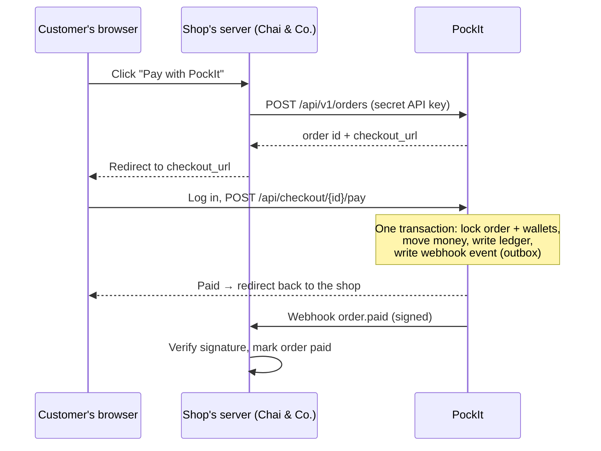

# ₹ PockIt

**Your money, pocketed.**


PockIt is a mini PayPal: a wallet for sending and requesting money between people, a
**"Pay with PockIt" checkout** that online shops can add to their websites (with refunds and
signed webhooks), and **risk rules** that hold suspicious payments for review.

The point of the project is that **money is never lost, duplicated or created out of nothing**,
even with double clicks, retries, two browser tabs, simultaneous requests, failing merchant
servers and payments stuck in review. That's proven by 107 tests, including race tests that fire
real concurrent requests at PostgreSQL.

**Live demo:** `https://YOUR-APP.onrender.com` (click **Try the demo account**, then visit the **Demo shop**)
**API docs:** `https://YOUR-APP.onrender.com/api/docs`

**Stack:** Django + Django REST Framework · PostgreSQL · JWT and API-key auth · HTML/CSS/vanilla JS ·
Swagger (drf-spectacular) · GitHub Actions · Docker · Render

---

## Features

**For people**

| | |
| --- | --- |
| **Wallet** | Sign up and get a ₹0 wallet. Add money with a simulated top-up. |
| **Send money** | To any user by email, with an optional note ("Movie tickets"). |
| **Recipient check** | As you type an email, PockIt shows who it belongs to ("✓ Priya Sharma") before any money moves, like UPI showing the payee's name. |
| **Request money** | Ask someone for money. They can pay or decline; you can cancel while it's waiting. |
| **Passbook** | Every movement with a running balance, including shop payments, refunds and held payments. |

**For businesses ("Pay with PockIt")**

| | |
| --- | --- |
| **Merchant accounts** | Any user can start accepting payments from the **Business** page and gets a secret API key (`sk_test_…`). |
| **Hosted checkout** | The shop's server creates an order; the customer pays on PockIt's checkout page and is sent back to the shop. |
| **Refunds** | Full or partial, from the Business page or the API. Never more than was paid. |
| **Webhooks** | `order.paid`, `order.on_hold`, `order.declined`, `refund.created`, signed with HMAC-SHA256 and retried with backoff. |
| **Demo shop** | **Chai & Co.** at `/shop/` is a pretend merchant that uses all of the above, so you can watch the whole flow. |

**Risk and review**

| | |
| --- | --- |
| **Risk rules** | New account sending over ₹5,000 · more than 5 payments in 10 minutes · first payment to someone over ₹10,000 · any payment of ₹50,000+ |
| **Holds** | A risky payment leaves the sender but waits in a **holding wallet** until someone approves it (money goes on) or rejects it (money comes back). |
| **Review queue** | Approve or reject held payments in the admin (`/admin` → Payment holds). |

**Demo logins** (after `python manage.py seed_demo`): customer `demo@pockit.app`, shop owner
`chaiandco@pockit.app`, password `pockit-demo-2026` for both. The log-in page has buttons for each.

---

## How "Pay with PockIt" works



The shop marks the order paid **only when the signed webhook arrives**, never because the browser
was redirected back. Anyone can fake a redirect; nobody can fake PockIt's signature.

## Engineering highlights

| Problem | Solution | Where |
| --- | --- | --- |
| Server crashes halfway through a payment | Every money movement runs inside one database transaction | `transaction.atomic()` in `wallets/services.py` |
| Two ₹80 transfers from ₹100 at the same time | Wallet rows are locked (`SELECT … FOR UPDATE`); the second waits, then sees ₹20 and is refused | `lock_wallets()` |
| Deadlocks between opposite payments | One lock order everywhere: request/order row → hold row → wallets by ascending id | `lock_wallets()`, `_lock_hold_and_parent()` |
| Double click or network retry pays twice | Every payment and refund carries an `Idempotency-Key`; a repeat returns the saved result | `find_previous()` / `remember()` |
| A checkout paid from two tabs | The order row is locked and its status re-checked; the second payment gets `409` | `pay_order()` |
| Two partial refunds that together exceed the order | Same order lock, plus a database `CHECK (refunded_amount <= amount)` | `refund_order()`, `Order.Meta` |
| Telling the merchant about a payment that was rolled back, or forgetting to | **Transactional outbox**: the webhook event is written in the same transaction as the payment, and sent only after commit | `merchants/webhooks.py` |
| Merchant's server is down | Retries with exponential backoff (30 s, 1 min, 2 min…), then `FAILED`; a worker process retries in the background | `deliver_due()`, `deliver_webhooks` command |
| Holding a DB transaction open while waiting on a slow merchant | Claim the event with a short lease, send outside the transaction, then record the result | `deliver()` |
| Fake or replayed webhooks | HMAC-SHA256 over `timestamp.body`, constant-time compare, 5-minute replay window | `sign()` / `verify()` |
| The same webhook delivered twice, or out of order | The shop records processed event ids and never moves an order backwards | `demoshop/views.py` |
| A leaked database exposes API keys | Only a SHA-256 hash of each key is stored; the key is shown once | `Merchant.api_key_hash` |
| Merchants pointing webhooks at internal servers (SSRF) | Webhook URLs must resolve to public addresses in production | `validate_webhook_url()` |
| Suspicious payments | Explainable risk rules; held money sits in a **system holding wallet**, so the double-entry ledger stays balanced | `wallets/risk.py`, `send_or_hold()` |
| Approve and Reject clicked at the same instant | The hold row is locked; exactly one wins | `release_hold()` / `reject_hold()` |
| Proving no money went missing | `reconcile`: every balance = sum of its ledger rows, all movements sum to ₹0, the holding wallet = open holds, no order over-refunded | `manage.py reconcile` |
| A bug saves a negative balance | The database refuses it: `CHECK (balance >= 0)` | `Wallet.Meta` |
| Rounding errors | Money is `Decimal`, never `float` | everywhere |
| Paying the wrong person because of a typo | The recipient's name is shown before paying; unknown emails are blocked | `RecipientLookupView` |
| Spam | Rate limits on transfers, requests, lookups and checkout | `settings.py` |

## Tests

**107 tests**, run on every push by GitHub Actions against PostgreSQL 16:

- **Wallet:** validation, auth, double clicks, history privacy, rate limits, recipient check
- **Requests:** pay, decline, cancel, wrong user, paying twice, insufficient balance
- **Risk:** every rule, holds, approve, reject, held request payments, held checkouts, idempotent retries of held payments
- **Checkout and refunds:** API-key auth and key rotation, paying, expiry, own-shop, partial and full refunds, over-refunds, merchant balance too low
- **Webhooks:** signatures, tampering, replay window, retries with backoff, giving up, SSRF guard, and an end-to-end test where the demo shop receives real signed webhooks
- **Concurrency** (real threads, real row locks, PostgreSQL only):
  - two simultaneous ₹80 transfers from ₹100: exactly one succeeds
  - the same payment fired 10 times at once: charged once
  - A→B and B→A in parallel: no deadlock, no money created or lost
  - a request paid from 5 tabs at once: paid once
  - pay vs cancel at the same instant: exactly one winner
  - a checkout paid from 5 tabs at once: paid once
  - two refunds that together exceed the order: only one succeeds
  - approve vs reject a held payment at the same instant: exactly one wins

Each race test was checked by **removing the lock it protects**: the test then fails. A race test
that passes either way proves nothing.

---

## Run it locally

You need Python 3.12+. Docker is optional.

```bash
cd backend
python -m venv .venv
.venv\Scripts\activate          # Windows
# source .venv/bin/activate     # macOS / Linux
pip install -r requirements.txt
python manage.py migrate
python manage.py seed_demo      # demo customer, demo shop, sample history
python manage.py runserver
```

Open **http://127.0.0.1:8000**. Django serves the front end too, so this is the only terminal you need.

| URL | What |
| --- | --- |
| http://127.0.0.1:8000 | The app |
| http://127.0.0.1:8000/shop/ | Chai & Co. demo shop |
| http://127.0.0.1:8000/merchant.html | Business page (orders, refunds, API key, webhooks) |
| http://127.0.0.1:8000/api/docs | Interactive API docs |
| http://127.0.0.1:8000/admin | Admin and the risk review queue (`python manage.py createsuperuser` first) |

**Try the whole flow:** log in as the demo customer → **Demo shop** → buy a masala chai → pay →
you're sent back and the shop shows "Paid" once the webhook arrives → log in as the shop owner →
**Business** → refund it → the shop page updates again.

**Tests:**

```bash
python manage.py test -v 2
python manage.py reconcile
```

Without PostgreSQL the 8 concurrency tests are skipped (SQLite has no row locks).
To run them, start PostgreSQL and add a `.env` file:

```bash
docker compose up -d db
copy .env.example .env          # macOS / Linux: cp .env.example .env
python manage.py migrate
python manage.py test
```

**Everything in Docker:** `docker compose up --build`, then open http://localhost:8080.
This also starts a **worker** that retries failed webhooks.

## Deploy (free, on Render)

1. Push this project to GitHub.
2. On [render.com](https://render.com): **New → Blueprint**, then choose the repo and click **Apply**.
3. Render reads `render.yaml`, creates a PostgreSQL database and the web service,
   runs migrations, and creates the demo accounts and shop. Your app is live at `https://pockit-xxxx.onrender.com`.
4. Put that link at the top of this README and on your resume.

Free Render services sleep when idle, so the first visit after a while takes about 30 seconds.
The free plan has no background worker, so failed webhooks are retried when you press
**Retry** on the Business page (or run `deliver_webhooks` in Render's shell).

---

## API

**People** (log in, then send `Authorization: Bearer <access token>`)

| Method | Endpoint | Notes |
| --- | --- | --- |
| POST | `/api/auth/signup`, `/api/auth/login` | Returns JWT tokens |
| GET | `/api/users/lookup?email=` | Who owns this email? |
| GET | `/api/wallet` | Balance |
| POST | `/api/wallet/topup` | `amount` + `Idempotency-Key` |
| POST | `/api/transfers` | `to_email, amount, note?` + `Idempotency-Key`. `201` sent, `202` on hold |
| GET | `/api/transactions?page=N` | Passbook |
| GET/POST | `/api/requests` | List / create payment requests |
| POST | `/api/requests/{id}/pay` · `/decline` · `/cancel` | Pay needs an `Idempotency-Key` |

**Merchant API** (the shop's server, `Authorization: Bearer sk_test_…`)

| Method | Endpoint | Notes |
| --- | --- | --- |
| POST | `/api/v1/orders` | `amount, description, merchant_reference?, return_url?, cancel_url?` → `checkout_url` |
| GET | `/api/v1/orders/{id}` | Status, customer, refunds |
| POST | `/api/v1/orders/{id}/refunds` | `amount, reason?` + `Idempotency-Key` |

**Checkout** (the customer)

| Method | Endpoint | Notes |
| --- | --- | --- |
| GET | `/api/checkout/{id}` | Public: what am I paying for? |
| POST | `/api/checkout/{id}/pay` | Logged in + `Idempotency-Key`. `200` paid, `202` on hold |

**Business page** (the logged-in merchant): `/api/merchant` (GET, POST to sign up, PATCH),
`/api/merchant/rotate-key`, `/api/merchant/orders`, `/api/merchant/orders/{id}/refunds`,
`/api/merchant/webhooks`, `/api/merchant/webhooks/{id}/retry`.

Full details with "Try it out" buttons: `/api/docs`. Click-to-send examples: `api.http`.

### Verifying a webhook (on the merchant's side)

```python
import hashlib, hmac, time

def verify(secret: str, body: bytes, header: str) -> bool:
    parts = dict(p.split("=", 1) for p in header.split(","))      # "t=…,v1=…"
    expected = hmac.new(secret.encode(), f"{parts['t']}.".encode() + body, hashlib.sha256).hexdigest()
    fresh = abs(time.time() - int(parts["t"])) < 300              # reject replays
    return fresh and hmac.compare_digest(expected, parts["v1"])
```

## Project structure

```
pockit/
├── .github/workflows/tests.yml   # CI: tests on PostgreSQL for every push
├── backend/
│   ├── config/                   # settings (risk rules, rate limits), urls
│   ├── accounts/                 # sign up / log in, recipient lookup
│   ├── wallets/
│   │   ├── models.py             # Wallet, LedgerEntry, PaymentRequest, PaymentHold, IdempotencyKey
│   │   ├── services.py           # ← all money movement: transactions, locks, idempotency, holds
│   │   ├── risk.py               # the risk rules
│   │   ├── admin.py              # review queue: approve / reject held payments
│   │   └── management/commands/  # reconcile, seed_demo
│   ├── merchants/
│   │   ├── models.py             # Merchant, Order, Refund, WebhookEvent
│   │   ├── services.py           # checkout payments and refunds
│   │   ├── webhooks.py           # outbox, signing, delivery with retries
│   │   ├── auth.py               # secret API keys
│   │   └── management/commands/  # deliver_webhooks (worker)
│   └── demoshop/                 # Chai & Co.: a pretend merchant server + webhook receiver
├── frontend/
│   ├── index.html, dashboard.html
│   ├── checkout.html             # PockIt's hosted checkout
│   ├── merchant.html             # Business page
│   └── shop/                     # Chai & Co. storefront
├── docker-compose.yml            # db, backend, webhook worker, nginx
├── render.yaml                   # one-click deploy
└── api.http                      # click-to-send requests in VS Code
```

## Design decisions

- **One place moves money.** `post_entries()` is the only function that changes balances. Transfers, request payments, checkout, refunds and hold reviews all go through it, so the ledger rules can't drift apart.
- **Lock, then check the idempotency key.** Because the key is checked while the payer's wallet is locked, two copies of the same request can't both get past the check.
- **Risk is checked before taking locks.** The rules only read data, so running them first keeps lock times short and lets the holding wallet join the normal lock order. The cost: two simultaneous payments might both see "4 recent payments". That's acceptable for a soft velocity rule.
- **Held money lives in a real wallet.** Instead of a "pending" flag, a held payment moves into a system wallet. The ledger stays balanced at every moment, and `reconcile` can check the holding wallet equals the open holds.
- **Refunds skip the risk rules.** Money can only go back to the customer who paid, capped at what they paid.
- **Webhooks use an outbox, not "send then hope".** Sending an HTTP request inside the payment transaction could tell the merchant about a payment that then rolls back; sending it after commit without a record could lose it if the server crashes. Writing the event in the transaction and delivering it afterwards avoids both.
- **Only successful payments are remembered** under their idempotency key. A failed attempt (say, insufficient balance) rolls back completely, so the user can top up and retry with the same key. Stripe also stores failures; that's a reasonable alternative.
- **The ledger is append-only.** Nothing edits or deletes history, even in the admin.
- **State machines everywhere.** Requests (`PENDING → ON_HOLD → PAID…`), orders (`CREATED → PAID → PARTIALLY_REFUNDED → REFUNDED`), holds (`HELD → RELEASED | REJECTED`), webhook events (`PENDING → DELIVERED | FAILED`). Every transition happens under a row lock.

## Ideas for later

- Linked bank accounts and "Transfer to bank" with asynchronous settlement
- Transaction PIN for payments above a limit
- Multi-currency wallets (₹ and $) with conversion in the ledger
- Expire old idempotency keys and webhook events with a scheduled job
- A machine-learning risk score alongside the rules
